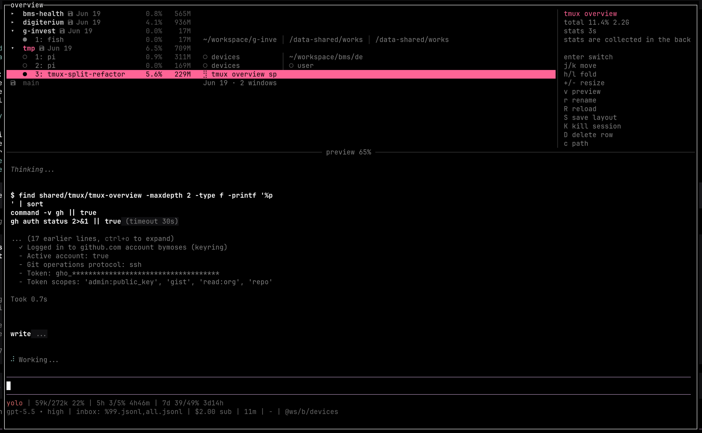

# tmux-overview

A small rustc-only tmux session/window overview popup.



## Features

- Lists tmux sessions and windows, with `s` toggling CPU/RSS stats.
- Nests slash-named sessions (`project/worker`) under their live parent session.
- Draws a togglable tree (`t`) with white session edges and gray window branches.
- Hides internal `__` helper sessions until `.` toggles them visible, rendering friendly `◫`/`󰚩` labels.
- Live pane-title/window labels.
- Preview pane with multi-pane layout rendering.
- Save, restore, rename, delete, and kill session/window flows.
- Renaming a session also renames every slash-named descendant.
- Add windows/sessions from the popup (`a`, then `name` for a window or `s:name` for a session).
- Watchlist section for pinned windows (`w` toggles the selected window).
- Bright badges for agent panes that stopped without being reviewed.
- Persisted session fold state, preview visibility/size, and cursor position.
- No Cargo project required; builds directly with `rustc`, falling back to Docker.

## Prerequisites

Runtime:

- `tmux`
- `ps`, `stty`, `date`, and a POSIX-ish shell environment

Build, choose one:

- `rustc`
- or `docker` for the wrapper's fallback build path, using `rust:1-alpine` by default

Tests:

- `bun`
- `tmux`
- `rustc` or `docker`

## Install

Clone somewhere under your tmux config, for example:

```sh
git clone https://github.com/bymoses/tmux-overview ~/.config/tmux/tmux-overview
```

Add a binding to `~/.config/tmux/tmux.conf`:

```tmux
bind-key s display-popup -E -w 90% -h 90% -T "overview" "~/.config/tmux/tmux-overview/tmux-overview.sh"
bind-key -n M-s display-popup -E -w 90% -h 90% -T "overview" "~/.config/tmux/tmux-overview/tmux-overview.sh"
```

Reload tmux config, then press prefix + `s` or Alt+`s`.

## Agent alerts

Windows whose agent stopped, but that you have not looked at since, are badged
in the picker: `● 4m` on the window row (`◌` when the agent exited, `●2` when
two panes stopped), and `● N` on every ancestor session row, so a collapsed or
`__`-hidden `__agents` session still surfaces its pending work.

The "not reviewed yet" part is tmux's own bookkeeping rather than extra state:
a producer rings the terminal bell when it stops, and `window_bell_flag` stays
set until the window is focused. A pane counts as an agent when it publishes
`@agent_state` (`idle`, `exited`, `blocked`, `working`) as a tmux pane option:

```sh
tmux set-option -p -t "$TMUX_PANE" @agent_state idle
tmux set-option -p -t "$TMUX_PANE" @agent_idle_at "$(date +%s)"
printf '\a' > /dev/tty
```

`@agent_idle_at` (epoch seconds) drives the age shown in the badge. Panes that
only ring the bell still light up if their command is a known agent (`pi`,
`claude`, `codex`, `aider`), so producers need no integration at all.

## Session naming and keys

- `parent/child` appears beneath a live `parent` session; each level folds independently.
- Components beginning with `__` are hidden by default. Press `.` to toggle them; legacy symbol-marked helpers remain recognized.
- tmux keeps the real names `<session>/__float` and `<session>/__agents`; the overview displays those components as `◫ float` and `󰚩 agents`.
- Press `s` to toggle compact and CPU/RAM stats views.
- Press `t` to toggle tree connectors.
- Hidden-session visibility, tree view, and stats mode persist across overview openings.

## Build/run

Use the Makefile so builds go through the same wrapper used at runtime. The wrapper writes the binary to `${XDG_CACHE_HOME:-$HOME/.cache}/tmux-overview/tmux-overview` when sources change:

```sh
make build
make run
```

`make build` calls `./tmux-overview.sh --build-only` and automatically uses local `rustc` or falls back to Docker.

## Tests

End-to-end tests are Bun-based and drive isolated tmux servers. Run the complete project check with:

```sh
make check
```
